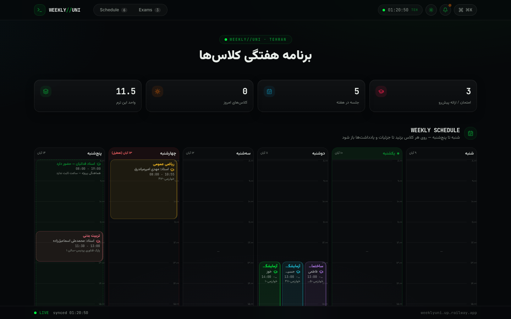

# WEEKLY//UNI — University Weekly Planner PWA

> A bilingual (English / فارسی) terminal-styled weekly schedule for university students — fully RTL, Jalali-aware, with smart reminders and signature notification sounds.




**🔴 Live demo: [weeklyuni.up.railway.app](https://weeklyuni.up.railway.app)**

---

## ✨ Features

- 📅 **RTL Weekly Grid** — Saturday-first Iranian academic week (شنبه → پنج‌شنبه) with mirrored hour axis, a live red "now" line and today highlighting
- 👨‍🏫 **Professor Names Inline** — every class block (desktop grid and mobile accordion cards) shows its instructor directly, no modal needed
- 🔀 **Overlap Columns** — parallel classes (e.g. three Monday labs) render side-by-side in automatic overlap columns
- 🔔 **Smart Reminders** — classes & exams 90 + 60 minutes ahead, presentations 4 days + 2 days before (plus minute-level), boot catch-up, dedupe, vibration patterns
- 🔊 **Three Signature Sounds** — unmistakable Web Audio synth voices: campus bell (class), triple siren (exam), pentatonic harp arpeggio (presentation)
- 📆 **Jalali Calendar** — native Persian (Solar Hijri) date picker & display everywhere, Persian digits, Asia/Tehran clock
- 🎨 **Per-course Colors** — each class carries its own accent color across grid, cards and modals
- 🧭 **Command Palette** — searchable Persian command menu (`⌘K` / `Ctrl+K`)
- 📝 **Exam Tracker & Notes** — countdowns in Persian, per-class notes
- 📱 **PWA** — installable, service-worker notifications, mobile accordion layout
- 🌓 **Dark "Midnight Campus" theme** with ambient aurora background

## 🛠 Tech Stack

| Layer | Choice |
| --- | --- |
| Framework | [Next.js 16](https://nextjs.org) (App Router) + TypeScript 5 |
| Styling | Tailwind CSS 4 + shadcn/ui (New York) + Lucide icons |
| State | Zustand + `useSyncExternalStore` |
| Audio | Web Audio API synth engine (custom) |
| Calendar | Native `fa-IR-u-ca-persian` Intl + custom helpers |
| Database | JSON file (`data/db.json`) persisted on a Railway Volume |
| Deployment | Railway · Docker multi-stage (bun build → Node standalone) |

## 🚀 Getting Started

```bash
# install
bun install

# run dev server (http://localhost:3000)
bun run dev

# lint
bun run lint
```

The schedule seed lives in `src/lib/db.ts` and `data/db.json` — edit either, or use the in-app editor / API.

## 🔌 API

| Endpoint | Methods | Description |
| --- | --- | --- |
| `/api/health` | GET | Health check (class/exam counts) |
| `/api/schedule` | GET | Full schedule payload |
| `/api/classes` | GET, POST | List / create classes |
| `/api/classes/[id]` | GET, PUT, DELETE | Read / partial-update / delete a class |
| `/api/exams` · `/api/exams/[id]` | GET, POST, PUT, DELETE | Exam tracking |
| `/api/notes` | GET, PUT | Per-class notes |

## ☁️ Deployment (Railway)

- `railway.json` builds with the repo `Dockerfile` (multi-stage: bun deps/build → Node runtime)
- Start command: `node server.js` (Next.js standalone output)
- Health check: `/api/health`
- A volume mounted at `/app/data` persists the JSON database across deploys

```bash
railway link   # then
railway up -d
```

## 📁 Project Structure

```
src/
├── app/                  # App Router pages + API routes
├── components/terminal/  # schedule-grid, navbar, reminders, exam-tracker, ...
└── lib/                  # db, types, tehran (time), jalali, reminders, sounds, store
data/db.json              # JSON database (seeded from src/lib/db.ts)
public/sw.js              # service worker (notifications)
```

## 📄 License

Released under the [MIT License](LICENSE).

## 👤 Author

**[Dani-Devlop](https://github.com/Dani-Devlop)**
